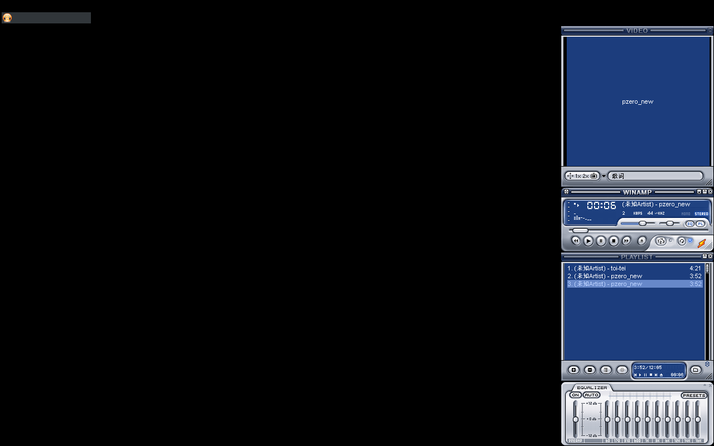

# TTPlayerV2M

为 [千千静听社区版](https://github.com/Sonic853/TTPlayer) 编写的
**Farbrausch V2（.v2m）** 解码器，使用 TTPlayer 的 Sound AddIn ABI
（导出 `ttpGetSoundAddIn`）。



## 状态

- 解码器：`ttp_v2m.dll`（Win32，i386）
- 宿主接口：`ttpGetSoundAddIn` → `AddIn` → `ReaderCreator`
  → `Reader` / `Metadata`
- 输出：固定 **44100 Hz / 16-bit / 双声道**
- 支持旧版 V2M 的版本检测与转换（`v2mconv`）
- 支持时长、Seek、Title 元数据
- 对循环型 V2M 强制在报告时长处返回 `S_FALSE`，不会无限播放
- 静态链接 libgcc / libstdc++ / winpthreads，DLL 仅依赖
  `KERNEL32.dll`、`msvcrt.dll`、`ole32.dll`

## 构建

依赖：

- CMake ≥ 3.20
- Ninja
- 32 位 MinGW-w64 交叉编译器：`i686-w64-mingw32-g++`、
  `i686-w64-mingw32-gcc`，并带有静态 `libstdc++` 与
  `libwinpthread`

本机工具链从 Fedora 43 的 `mingw32-*` RPM 解包到
`/home/mrfox/Library/dev/toolchains/mingw32`。其他路径可通过
`MINGW32_ROOT` 指定（应指向包含 `usr/bin/i686-w64-mingw32-g++`
的前缀）。

```bash
export MINGW32_ROOT=/path/to/mingw32-prefix
./tools/build.sh
```

等价的手动命令：

```bash
export PATH="$MINGW32_ROOT/usr/bin:$PATH"
cmake -S . -B build -G Ninja \
  -DCMAKE_TOOLCHAIN_FILE=cmake/mingw32.cmake \
  -DCMAKE_BUILD_TYPE=Release
cmake --build build
```

产物：

- `build/ttp_v2m.dll`
- `build/ttp_v2m_test.exe`（ABI 测试宿主）

## 安装

把 `build/ttp_v2m.dll` 复制到千千静听的 `AddIn` 目录：

```bash
cp build/ttp_v2m.dll /path/to/TTPlayer/AddIn/
```

重启播放器后，`.v2m` 文件会由 `Farbrausch V2 Reader` 打开。

## 测试

```bash
./tests/run.sh
```

测试宿主通过真实的 `ttpGetSoundAddIn` 入口加载 DLL，走完整的
`AddIn → ReaderCreator → Reader/Metadata` 调用链，把音频写成
WAV 到 `$HOME/.cache/ttpv2m`，并验证时长、Seek、峰值和 EOF。

本机结果（Wine 11，2026-11-19）：

| 文件 | 报告时长 | 实际解码 | 峰值 | RMS | 结果 |
| --- | ---: | ---: | ---: | ---: | --- |
| `pzero_new.v2m` | 232806 ms | 233.83 s / 41,247,264 B | 1.0000 | 0.1892 | PASS |
| `v2_zeitmaschine_new.v2m` | 166536 ms | 166.95 s / 29,450,784 B | 1.0000 | 0.1186 | PASS |

TTPlayer 集成：在 Xvfb 下启动
`TTPlayerRebuild.exe pzero_new.v2m`，界面显示 `pzero_new`、
`3:52`、`44 kHz stereo`，播放进度正常推进（见
`docs/ttplayer.png`，截图时间 00:08）。

## 结构

```text
include/ttp_player_abi.h   TTPlayer Sound AddIn 接口定义
src/plugin.cpp             ttpGetSoundAddIn / AddIn / ReaderCreator
src/reader.cpp             Reader + Metadata 实现（V2M 解码）
src/common.h               COM 辅助、HRESULT 保护、IStream 读取
src/v2m/                   Farbrausch V2 上游源码（public domain）
src/v2m/v2init.cpp         v2mconv 所需的版本/尺寸表
tests/test_host.cpp        独立 ABI 测试宿主
tests/data/                上游示例 V2M
docs/ABI.md                接口与行为说明
tools/build.sh             交叉编译脚本
tools/package.sh           生成 dist/ 与 SHA256
```

## V2 上游移植说明

`src/v2m/` 来自
[farbrausch/fr_public](https://github.com/farbrausch/fr_public/tree/master/v2)
的 `v2` 目录，原始代码为 public domain（见
`src/v2m/LICENSE.txt`）。为在 MinGW 32 位下编译，做了以下最小修改：

1. `v2mplayer.cpp`：把 MSVC 内联汇编（`__asm`）替换为等价的
   64 位 C++ 运算和 `memset`；启用
   `V2MPLAYER_SYNC_FUNCTIONS` 以编译 `CalcPositions`。
2. `types.h`、`v2mplayer.h`：`__int64` / `unsigned __int64`
   改为 `long long` / `unsigned long long`。
3. `v2init.cpp`：从 `sounddef.h` 的 `v2parms` / `v2gparms`
   重建 `v2version`、`v2vsizes`、`v2gsizes`，并补上每个 patch
   末尾的 `1 + 255*3` 调制数据。
4. `reader.cpp`：读取整个 IStream（上限 256 MiB），调用
   `CheckV2MVersion` / `ConvertV2M`，用
   `V2MPlayer::CalcPositions` 计算时长，并在达到时长后返回
   `S_FALSE`；修复了停止后尾音计数反复重置导致的无限输出。

上游 `synth_core.cpp` 是 C++ 合成器实现，因此不需要 NASM/YASM，
也不需要 Winamp/Buzz SDK。

## 已知限制

- 仅注册 `.v2m`，不处理旧式 `.v2` 或其他 tracker 格式。
- 打开时把整个流读入内存，单文件上限 256 MiB；不支持边下边播。
- 固定 44.1 kHz / 16-bit / stereo，不做重采样。
- `RONAN` 语音合成未启用；使用 speech 声部的 V2M 中人声部分
  不会发声（上游 C++ 核在未定义 `RONAN` 时如此）。
- 无配置界面；`SetCallback` 为空实现。
- 时长来自 tempo map 的 `CalcPositions`，末尾附加 2 秒；对极少数
  没有全局速度事件的旧文件会退化为文件头 `maxtime/timediv`。

## 许可

- 本仓库新增代码（插件、ABI 头、测试宿主、脚本）：MIT，见
  `LICENSE`。
- `src/v2m/`：Farbrausch V2 public domain，见
  `src/v2m/LICENSE.txt`。
- TTPlayer AddIn 的 GUID 与方法布局来自 TTPlayerRebuild 参考插件
  的实际 ABI；本仓库的 `include/ttp_player_abi.h` 为重新编写的
  接口声明，不包含其实现代码。
